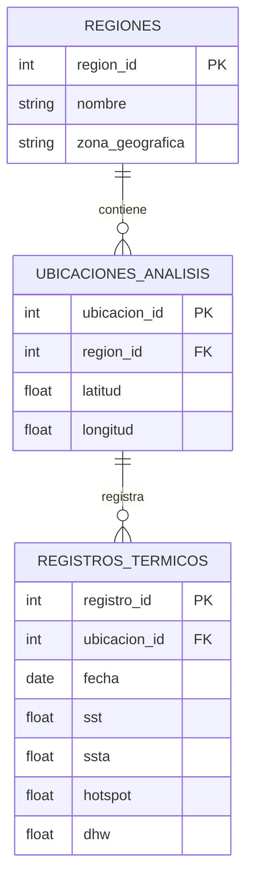

# NF2 - Documentación del proyecto

**Proyecto:** Monitorización y predicción del estrés térmico en arrecifes de coral

**Apartados:** 7, 8 y 9

**Responsable:** Javier Badías

## 7. Modelo de datos

### 7.1. Descripción general

Para organizar la información del proyecto se propone un modelo de datos formado por tres tablas relacionadas entre sí.

Estas tablas permitirán guardar las regiones de estudio, sus ubicaciones geográficas y los registros históricos de temperatura y estrés térmico.

El objetivo es mantener los datos organizados para facilitar su análisis y su posterior utilización en los modelos de Machine Learning.

### 7.2. Estructura de las tablas

**Tabla REGIONES**

Contendrá las zonas geográficas que vamos a estudiar, como la Gran Barrera de Coral (Australia) y algunas regiones del Caribe.

| Campo | Tipo | Descripción |
|---|---|---|
| region_id | Entero | Identificador único. Clave primaria (PK) |
| nombre | Texto | Nombre de la región |
| zona_geografica | Texto | País o zona geográfica |

**Tabla UBICACIONES_ANALISIS**

Almacenará los puntos geográficos concretos de los que obtendremos información ambiental.

| Campo | Tipo | Descripción |
|---|---|---|
| ubicacion_id | Entero | Identificador único. Clave primaria (PK) |
| region_id | Entero | Identificador de región. Clave foránea (FK) |
| latitud | Decimal | Coordenada de latitud |
| longitud | Decimal | Coordenada de longitud |

**Tabla REGISTROS_TERMICOS**

Contendrá los datos históricos de temperatura y los principales indicadores de estrés térmico asociados a cada ubicación y fecha.

| Campo | Tipo | Descripción |
|---|---|---|
| registro_id | Entero | Identificador único. Clave primaria (PK) |
| ubicacion_id | Entero | Identificador de ubicación. Clave foránea (FK) |
| fecha | Fecha | Fecha de la observación |
| sst | Decimal | Temperatura superficial del mar, en °C |
| ssta | Decimal | Anomalía de temperatura, en °C |
| hotspot | Decimal | Indicador de exceso térmico, en °C |
| dhw | Decimal | Estrés térmico acumulado, en °C-semanas |

### 7.3. Relaciones entre las tablas

Se establecen las siguientes relaciones:

- REGIONES → UBICACIONES_ANALISIS: relación 1:N. Una región puede contener varias ubicaciones.
- UBICACIONES_ANALISIS → REGISTROS_TERMICOS: relación 1:N. Una ubicación puede tener múltiples registros correspondientes a diferentes fechas.

Las claves primarias permitirán identificar cada elemento y las claves foráneas servirán para relacionar las tablas.

También se controlarán los registros duplicados, teniendo en cuenta la ubicación, fecha y versión de la fuente de datos utilizada.

### 7.4. Consideraciones del modelo

Este modelo es provisional y podrá adaptarse cuando se descarguen los datos reales.

Será necesario comprobar sus formatos, unidades, resolución geográfica y temporal, así como la forma de relacionar los datos de distintas fuentes.

En una primera fase se utilizarán los datos necesarios para estudiar unas pocas regiones, evitando una estructura demasiado compleja.

---

## 8. Datos: fuentes, calidad y riesgos

### 8.1. Fuentes de datos

El proyecto utilizará principalmente datos ambientales históricos y geográficos procedentes de fuentes públicas.

**NOAA Coral Reef Watch**

Será nuestra fuente principal para analizar la temperatura del mar y los indicadores de estrés térmico.

Las variables previstas son:

- SST: temperatura superficial del mar.
- SSTA: anomalía de temperatura.
- HotSpot: exceso térmico respecto al valor de referencia.
- DHW: indicador de estrés térmico acumulado.
- BAA: niveles de alerta relacionados con el riesgo de blanqueamiento.

NOAA proporciona productos con una resolución espacial aproximada de 5 km y actualizaciones diarias. Los datos están disponibles, entre otros formatos, en NetCDF4.

**Allen Coral Atlas**

Se utilizará para obtener información geográfica sobre la localización y distribución de los arrecifes de coral.

Permitirá seleccionar las zonas que queremos estudiar y relacionarlas con los datos ambientales.

Las capas geográficas podrán descargarse en formatos adecuados para su tratamiento, según el producto seleccionado.

**Otras fuentes**

Si fuera necesario, se estudiará la incorporación de observaciones de blanqueamiento procedentes de fuentes científicas, siempre que tengan datos suficientes y condiciones de uso compatibles.

### 8.2. Licencias y uso de los datos

Los datos de NOAA Coral Reef Watch disponibles en su web son de acceso público y pueden reutilizarse, citando correctamente la fuente.

Los mapas de hábitats y otros datos cartográficos propios de Allen Coral Atlas se distribuyen generalmente bajo licencia Creative Commons CC BY 4.0, que requiere atribución.

No todos los recursos visuales del Atlas tienen necesariamente la misma licencia, por lo que verificaremos las condiciones concretas de cada producto antes de incorporarlo.

### 8.3. Volumen y actualización

El volumen definitivo dependerá de las regiones elegidas, el periodo histórico y las variables descargadas.

Inicialmente se propone trabajar con una muestra limitada de datos de dos regiones, como Australia y el Caribe.

Los productos de NOAA seleccionados tienen una actualización diaria. En el caso de Allen Coral Atlas, se consultará la versión disponible de los mapas y se actualizará cuando corresponda.

No se ha calculado todavía el tamaño exacto de las descargas, ya que será necesario seleccionar los archivos y realizar una primera prueba.

### 8.4. Calidad de los datos

Antes de utilizar los datos se realizará una revisión para comprobar:

- Valores faltantes y posibles duplicados.
- Formatos de fechas y coordenadas.
- Unidades de las variables.
- Valores fuera de los rangos esperados.
- Diferencias de resolución entre fuentes.
- Coherencia entre registros temporales y geográficos.

La limpieza se realizará principalmente con Python y las librerías que se determinen durante el desarrollo.

### 8.5. Riesgos y posibles soluciones

| Riesgo | Posible solución |
|---|---|
| Datos incompletos | Revisar los valores faltantes y utilizar periodos con suficiente información |
| Archivos demasiado grandes | Limitar inicialmente las regiones y fechas |
| Diferencias entre fuentes | Revisar formatos, coordenadas y resoluciones antes de unir los datos |
| Datos insuficientes para predicción | Reducir el alcance y centrarse en indicadores como DHW |
| Problemas de licencia | Comprobar las condiciones y sustituir los recursos si es necesario |

Los datos utilizados serán principalmente reales. Si se necesitan datos simulados para realizar pruebas, se identificarán claramente para no confundirlos con observaciones reales.

---

## 9. Ética, legalidad y accesibilidad

### 9.1. Protección de datos personales

El proyecto se centrará en información ambiental, como temperaturas del mar, fechas, coordenadas geográficas e indicadores de estrés térmico.

En principio, estos datos no contienen información personal de individuos.

Por este motivo, no se prevé utilizar nombres, direcciones, teléfonos ni otros datos que permitan identificar personas.

Si en el futuro se incorporasen usuarios registrados u otra información personal, sería necesario revisar los requisitos aplicables de protección de datos, incluido el Reglamento General de Protección de Datos (RGPD).

### 9.2. Uso legal de las fuentes

Se utilizarán fuentes públicas y se respetarán las condiciones de acceso, reutilización y atribución de cada conjunto de datos.

También se documentará la procedencia de la información para que los resultados sean trazables.

No se utilizarán datos de acceso restringido sin autorización.

### 9.3. Posibles sesgos

Uno de los principales riesgos es que los datos no representen todas las regiones de la misma forma.

Por ejemplo, puede haber diferencias en la cobertura geográfica, resolución o disponibilidad histórica de las mediciones.

Además, un modelo entrenado con datos de una región podría no funcionar igual de bien en otra.

Para reducir estos problemas se propone:

- Revisar la calidad de los datos antes del entrenamiento.
- Comparar los resultados entre regiones.
- Evaluar los modelos con datos no utilizados durante el entrenamiento.
- Explicar las limitaciones de las predicciones.
- Evitar presentar los resultados como certezas absolutas.

### 9.4. Uso responsable de la Inteligencia Artificial

El sistema tendrá una finalidad de análisis y apoyo a la investigación ambiental.

Las predicciones de Machine Learning serán estimaciones basadas en los datos disponibles y no deberán interpretarse como diagnósticos definitivos del estado de los arrecifes.

Los resultados ayudarán a identificar posibles situaciones de estrés térmico, pero las decisiones de conservación corresponderán a especialistas.

### 9.5. Accesibilidad

Si el proyecto incluye un dashboard o interfaz visual, se aplicarán medidas básicas de accesibilidad:

- Textos claros y fáciles de entender.
- Contraste adecuado entre colores.
- Gráficos con títulos, leyendas y unidades.
- Evitar que el color sea la única forma de representar información.
- Navegación sencilla y, cuando sea posible, mediante teclado.

Se tomarán como referencia las recomendaciones básicas de accesibilidad WCAG.

El objetivo es que los resultados puedan consultarse y entenderse de forma sencilla por distintos tipos de usuarios.

---

## Fuentes consultadas

- NOAA Coral Reef Watch: https://coralreefwatch.noaa.gov/product/5km/index.php
- NOAA - Condiciones de uso y atribución: https://coralreefwatch.noaa.gov/satellite/docs/recommendations_crw_citation.php
- Allen Coral Atlas: https://allencoralatlas.org/
- Allen Coral Atlas - Recursos, licencias y descargas: https://allencoralatlas.org/resources/

**Nota:** Esta documentación corresponde al diseño inicial de la segunda fase. El modelo de datos, los formatos y las estimaciones deberán revisarse cuando el equipo comience a trabajar con los datasets reales.
